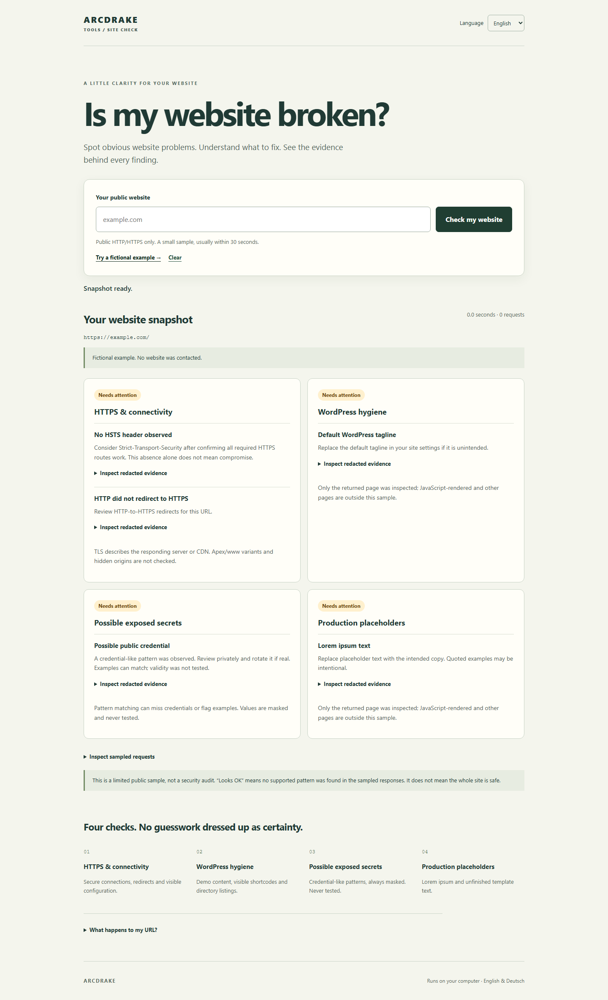

# Is My Website Broken?

Spot common website problems and understand what to fix, with readable explanations and redacted evidence. English and German are built in.

[Deutsch](README.de.md) · [Arcdrake](https://arcdrake.com/) · [More Arcdrake tools](https://tools.arcdrake.com/)

**Version 0.1.0-rc.1 — release candidate.** Run it on your own computer; there is no hosted version of this checker. It is a small public-response check, not a security audit or a guarantee that a website is safe.



[German mobile screenshot](docs/images/mobile-de.png). Screenshots use fictional data and make no requests to a real website.

## Try it locally

Install [Node.js 24 or newer](https://nodejs.org/). Download/extract the source, then open a terminal in its directory:

```sh
npm start
```

Open **http://127.0.0.1:43145** and choose **Try a fictional example**. No dependency installation is needed to run the app. Stop it with Ctrl+C.

For a real check, enter a public domain or HTTP(S) URL you are authorized to check. Your computer will contact that website. Do not enter private or signed links, credentials, or client-confidential data.

## What it checks

| Check | What you can learn |
| --- | --- |
| HTTPS & connectivity | Whether a sampled page is reachable, its final protocol, HTTP-to-HTTPS behavior, HSTS and certificate expiry when observable. |
| WordPress hygiene | Possible demo content, visible builder shortcodes and directory listings. WordPress presence alone is not a defect. |
| Possible exposed secrets | Selected credential-like patterns in the page and up to two linked same-origin JS/CSS files. Values are masked and never tested for validity. |
| Production placeholders | Lorem ipsum and selected unfinished template text. Intentional examples may also match. |

Each group says **Looks OK**, **Needs attention** or **Inconclusive**. Expand a finding to see its redacted URL, HTTP status, request chain, selected headers and response excerpt. “Looks OK” applies only to supported patterns in the inspected sample; it is not a site-wide verdict.

The scanner aims to return a useful result within about 30 seconds. Its total network budget is 25 seconds; a timeout produces limited or inconclusive results.

## Privacy and limits

- The app runs a server bound to your computer's loopback interface. Target websites see its requests and your outgoing IP address. DNS resolution uses your machine's configured resolver.
- Inputs and results are held in memory, not deliberately written to disk. Only language preference is stored in the browser. Your browser, operating system, DNS provider and target server may retain their own data.
- There are no accounts, analytics or AI service calls. The fictional example makes no target requests.
- Every query value is hidden in displayed URLs. Recognized credential patterns, sensitive-context path segments and long mixed letter/digit path segments are masked. **Masking is heuristic: short or unrecognized path secrets can still appear. Never paste a private or signed URL or share results without checking them.**
- At most six GET requests, including redirects, an HTTP variant and up to two same-origin assets; at most three redirects per fetch and 256 KiB per response. Requests share the overall budget. Asset sampling limits are shown in results.
- Only standard HTTP/HTTPS ports and validated public addresses are allowed. All DNS answers and each redirect are checked; the chosen address is pinned for the actual connection. TLS certificate verification remains enabled.
- Compressed responses and unsupported character encodings are not inspected. JavaScript is not executed. Logins, challenges, large responses or exhausted budgets may be inconclusive.
- Detection is deliberately narrow: entity-encoded/dynamic text and builder shortcodes with more than 200 attribute characters may be missed. Certificate observations describe the responding server/CDN, not a hidden origin. No apex/www expansion, crawling, private-file guessing or credential verification occurs.

Keep this loopback application local. It is not packaged as a public multi-user service. Hosting it publicly requires a separate abuse, deployment and privacy design.

## Development

The runtime uses Node.js built-ins. Playwright is a locked development dependency for browser tests.

```sh
npm ci --ignore-scripts
npx --no-install playwright install chromium
npm test
npm run check
npm run test:browser
```

On Linux, use `npx --no-install playwright install --with-deps chromium` to install browser prerequisites. Tests use synthetic responses and controlled loopback HTTP/TLS servers, not public targets. Keep ports **43146** and **43147** free for tests. Browser output is saved under ignored `.runtime/`; the test script closes its browsers and servers.

Windows with Node 24 and Chromium has been exercised locally. The included GitHub workflow is configured for Ubuntu 24.04; a workflow file alone is not a successful remote CI run. CPU timing assertions guard against pathological parsing, rather than promising identical timings on every machine.

The intentionally public TLS key under `tests/fixtures` is for isolated tests only; see its README. Never reuse or trust it in a real service.

See [contributing](CONTRIBUTING.md), [security reporting](SECURITY.md), [architecture](docs/ARCHITECTURE.md) and [third-party notices](THIRD_PARTY_NOTICES.md). Licensed under [MIT](LICENSE).
